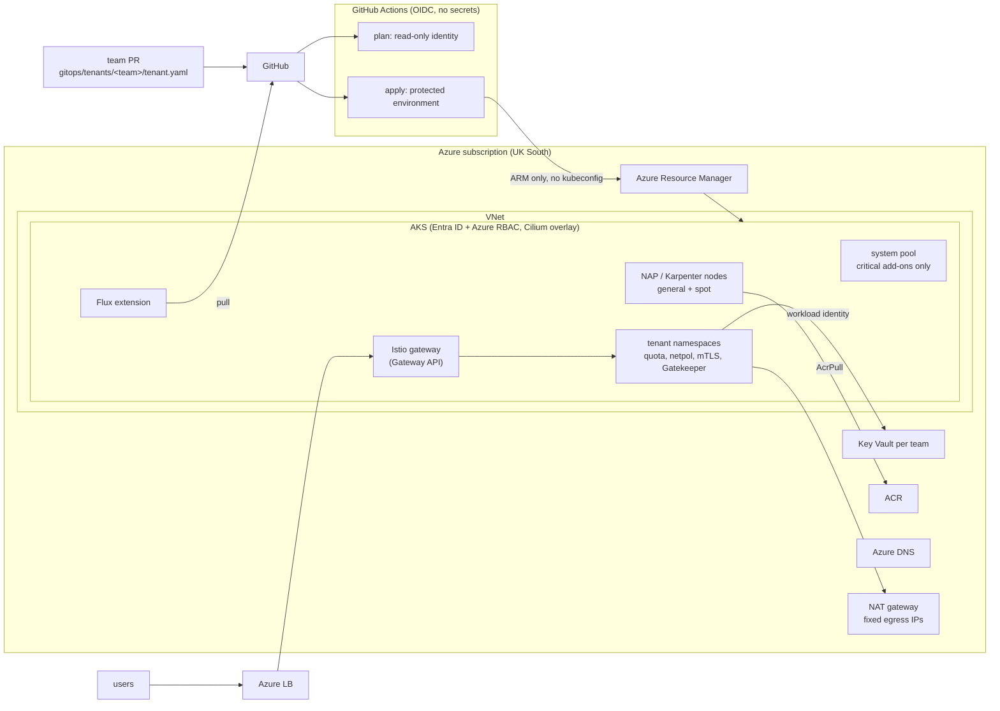

# terraform-azure-aks-platform

[](https://github.com/ozy31/terraform-azure-aks-platform/actions/workflows/ci.yml)


A self-service Kubernetes platform on Azure: an internal PaaS where application
teams onboard with one pull request and then deploy on their own, inside
guardrails the platform enforces.

- **Azure, with Terraform:** AKS with Entra ID and Azure RBAC, workload identity,
  Azure CNI Overlay with Cilium, Node Auto-Provisioning (Karpenter), NAT gateway
  egress, API Server VNet Integration, per-team Key Vaults, and a GitHub Actions
  pipeline that authenticates with OIDC.
- **Inside the cluster, with Flux:** Istio (Gateway API, strict mTLS),
  cert-manager, external-dns, External Secrets, OPA Gatekeeper and
  kube-prometheus-stack, installed and upgraded from Git.
- **Tenancy:** one `tenant.yaml` per team drives both sides: Azure RBAC on the
  team's namespace, a workload identity, a Key Vault, and in the cluster the
  namespace, quota, network policy, mesh policy and secret store.

> Region, IDs and domains are placeholders (UK South, `platform.example.co.uk`).
> Everything is validated in CI without an Azure subscription: Terraform tests
> use mocked providers, and manifests are checked against the real CRD schemas.

## Contents

- [Architecture](#architecture)
- [What a team gets](#what-a-team-gets)
- [Repository layout](#repository-layout)
- [Design decisions](#design-decisions)
- [Deploying](#deploying)
- [Validation](#validation)
- [Operations](#operations)

## Architecture



Terraform owns Azure and never talks to the Kubernetes API: Flux is installed
as the AKS extension and configured through ARM, and values only Terraform
knows reach manifests through Flux substitution. The API server can therefore
stay behind authorized IP ranges (or private) without breaking the pipeline.

## What a team gets

A team adds `gitops/tenants/<team>/tenant.yaml`:

```yaml
name: checkout
displayName: Checkout
ownerGroupId: 2f1c9a54-7d3e-4b8a-9c61-0e5d4a3b2c10   # Entra group
costCenter: CC-1042
serviceAccounts: [app, worker]
hostnames: [checkout.platform.example.co.uk, pay.platform.example.co.uk]
quota:
  requests.cpu: "40"
  requests.memory: 80Gi
```

After merge, without a ticket:

| Azure (Terraform, `modules/tenant`) | Cluster (Flux, `charts/tenant`) |
|---|---|
| `AKS RBAC Writer` on `<cluster>/namespaces/checkout` for the group | Namespace with Pod Security, cost-center label, Istio revision |
| `Cluster User Role` to fetch a kubeconfig | ResourceQuota and LimitRange |
| User-assigned identity, federated to each service account | Service accounts annotated for workload identity |
| Key Vault (RBAC, purge protection, VNet-only) | `SecretStore` bound to that vault and identity |
| Group gets Secrets Officer, identity gets Secrets User | Default-deny network policy plus DNS, istiod, gateway, HTTPS egress |
| | Istio `AuthorizationPolicy`: only the gateway and the namespace itself |

What the platform enforces (Gatekeeper, tested with `gator`):

- images only from the platform ACR or MCR, pinned to a tag or digest
- CPU and memory requests and a memory limit on every container
- no `LoadBalancer` or `NodePort` services: traffic goes through the shared Gateway
- `HTTPRoute` hostnames must be in the team's own `hostnames` list

Workload controllers are expanded (ExpansionTemplates), so a Deployment that
breaks a pod policy is rejected at `kubectl apply`, not when its ReplicaSet
fails later. [`examples/checkout-api`](examples/checkout-api) is a workload
that passes all of them, checked in CI.

## Repository layout

```
terraform/
  modules/
    network/              VNet, node / API server / private-endpoint subnets, NSG, NAT gateway,
                          private DNS zones for Key Vault and ACR
    aks/                  AKS cluster, control-plane and kubelet identities, role assignments
    platform-identities/  workload identities for cert-manager, external-dns, external-secrets
    tenant/               per-team RBAC, workload identity, Key Vault (+ terraform tests)
  envs/prod/              composition, Flux extension and configuration (+ terraform tests)
  bootstrap/github-oidc/  state storage and two federated GitHub identities (plan / apply)
gitops/
  infrastructure/
    controllers/          HelmReleases: Istio (base, CNI, istiod), cert-manager, external-dns,
                          External Secrets, Gatekeeper, Gateway API CRDs
    configs/              ClusterIssuer, ClusterSecretStore, shared Gateway, mTLS, NodePools
  monitoring/             kube-prometheus-stack, Grafana admin from Key Vault
    configs/              Istio PodMonitor, platform alert rules
    tests/                promtool unit tests for the alerts
  policies/
    templates/            ConstraintTemplates, ExpansionTemplates, sync config
    constraints/          constraints applied to tenant namespaces
    tests/                gator suite with allow and deny cases
  tenants/<team>/         tenant.yaml + HelmRelease of charts/tenant
charts/tenant/            namespace guardrails, with a JSON schema for its values
examples/checkout-api/    what a team deploys: Deployment, HTTPRoute, ExternalSecret, PDB
hack/                     validation scripts used by make and CI
docs/adr/                 architecture decision records
docs/runbooks/            onboarding, upgrades
```

Flux applies the `gitops/` paths as separate Kustomizations with explicit
ordering: `infra-controllers` → `infra-configs` and `policy-templates` →
`policies` → `tenants`, and `monitoring` → `monitoring-configs` after `infra-configs`.

## Design decisions

| ADR | Decision |
|---|---|
| [0001](docs/adr/0001-flux-through-the-aks-extension.md) | Flux as the AKS extension, configured through ARM: the pipeline needs no kubeconfig |
| [0002](docs/adr/0002-azure-rbac-for-kubernetes.md) | Entra ID only, Azure RBAC scoped to namespaces, local accounts disabled |
| [0003](docs/adr/0003-one-file-per-tenant.md) | One `tenant.yaml` drives Terraform and Helm |
| [0004](docs/adr/0004-upstream-istio-with-revision-tags.md) | Upstream Istio with revision tags and the Istio CNI, instead of the AKS add-on |
| [0005](docs/adr/0005-node-auto-provisioning.md) | Node Auto-Provisioning (Karpenter) instead of fixed node pools |
| [0006](docs/adr/0006-gatekeeper-policies-tested-in-ci.md) | Gatekeeper policies as code, tested with gator in CI |

A few smaller choices:

- **NAT gateway with a /30 public IP prefix for egress.** Four known IPs that
  partners can allow-list, and no SNAT port exhaustion on the cluster load balancer.
- **Private endpoints for ACR and Key Vault.** Nodes pull images and read
  secrets over private IPs, with the `privatelink` zones linked to the VNet.
  The public endpoints only accept the authorized ranges (admins, build agents).
- **API Server VNet Integration.** Node-to-API-server traffic stays in the VNet
  and the public endpoint is limited to authorized ranges.
- **Separate maintenance days.** Node images on Saturday, Kubernetes patches on
  Sunday, so an incident after a window has one suspect.
- **No consolidation in UK trading hours.** NodePool disruption budgets block
  voluntary node replacement from 08:00 on weekdays.
- **DNS-01 with workload identity.** Wildcard certificates for the shared
  Gateway, without solver pods or DNS credentials in the cluster.
- **Least-privilege pipeline.** The apply identity is Contributor plus RBAC
  Administrator with an ABAC condition: it can only grant the eight roles the
  platform assigns, so it cannot make itself Owner.

## Deploying

1. Bootstrap once, as a subscription owner:

   ```bash
   cd terraform/bootstrap/github-oidc
   terraform init && terraform apply \
     -var subscription_id=... -var entra_tenant_id=... -var state_storage_account_name=...
   ```

   Put the `backend_config` output in `terraform/envs/prod/backend.hcl` and the
   `github_variables` output into the repository's Actions variables. Create a
   `prod` environment with required reviewers.

2. Fill in `terraform/envs/prod/terraform.tfvars` (Entra group IDs, authorized
   ranges, ACR name, DNS zone).

3. Merge to `main`. The `terraform` workflow plans on pull requests and applies
   on `main` after approval. Flux then installs everything under `gitops/`.

4. Delegate the DNS zone to the `dns_name_servers` output and store
   `grafana-admin-user` / `grafana-admin-password` in the platform Key Vault.

## Validation

`make check` runs what CI runs:

| Target | What it checks |
|---|---|
| `make terraform` | `fmt`, `init` and `validate` for every module, environment and the bootstrap |
| `make tftest` | `terraform test` with mocked providers: tenant RBAC scope, one federated credential per service account, Key Vault name length, input validation, every tenant directory onboarded, every Flux variable provided, Kustomization ordering |
| `make tflint` | tflint with the azurerm ruleset |
| `make tenants` | tenant name matches its directory, no hostname claimed twice, every `${VAR}` in `gitops/` is set by Terraform |
| `make manifests` | kubeconform in strict mode against the pinned CRDs (Flux, Istio, Gateway API, cert-manager, External Secrets, Gatekeeper, Karpenter), with Flux variables resolved; the tenant chart rendered per tenant; every platform HelmRelease rendered with its exact chart version and values |
| `make policies` | `gator verify` with allow and deny cases for every policy; the example workload must pass the real constraints, and a non-compliant Deployment must be denied through the ExpansionTemplates |
| `make alerts` | `promtool` lint and unit tests for the platform alerts (Flux drift, Gatekeeper errors, certificate expiry, gateway 5xx per tenant, quota) |
| `make lint shell security` | yamllint, shellcheck, trivy |

## Operations

- [Onboarding a team](docs/runbooks/onboarding.md): one PR, what happens after merge, hand-over, offboarding
- [Upgrades](docs/runbooks/upgrades.md): node images, Kubernetes patch and minor versions, platform charts, Istio canary by revision, policy roll-out

| Situation | First step |
|---|---|
| Team cannot deploy: `admission webhook "validation.gatekeeper.sh" denied` | The message names the policy and the field; the fix is in the team's manifest, or a reviewed change to the constraint |
| Pods pending | `kubectl get nodeclaims` and the NAP events: NodePool limits, quota, or a zone without capacity |
| Certificate not issued | `kubectl describe certificate -n istio-ingress wildcard`, then the cert-manager logs: the identity needs DNS Zone Contributor on the zone |
| `TenantQuotaNearlyFull` / `GatewayHighErrorRate` | Carry a `tenant` label for routing to the owning team; quota changes go through the team's `tenant.yaml` |
| Something in Git is not in the cluster | `flux get kustomizations` and `flux get helmreleases -A`: the first failing item blocks the ones that depend on it |

## License

MIT
